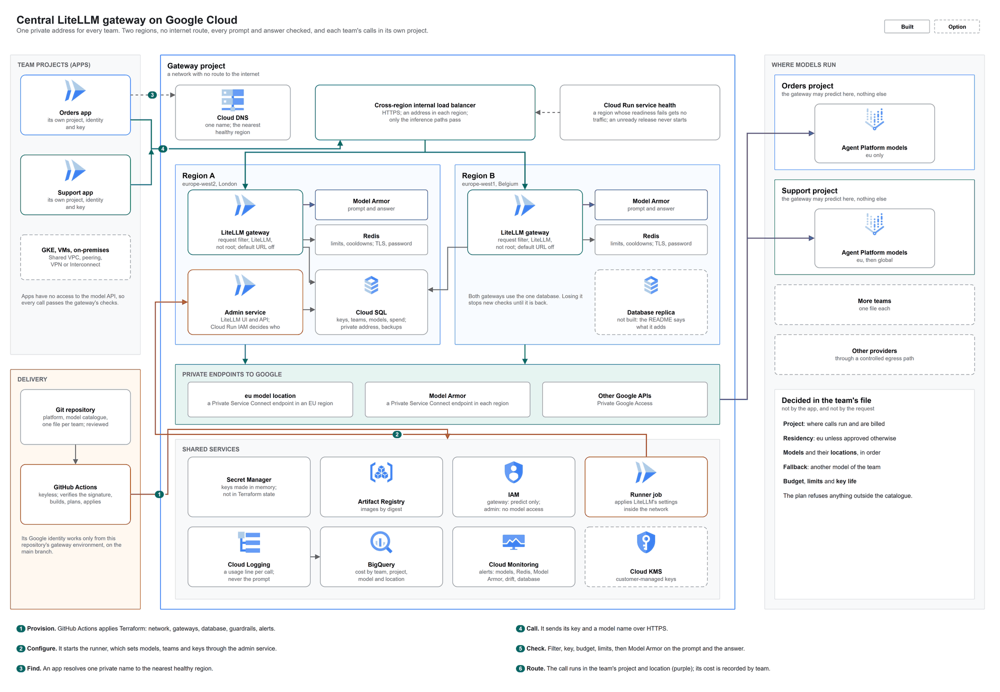
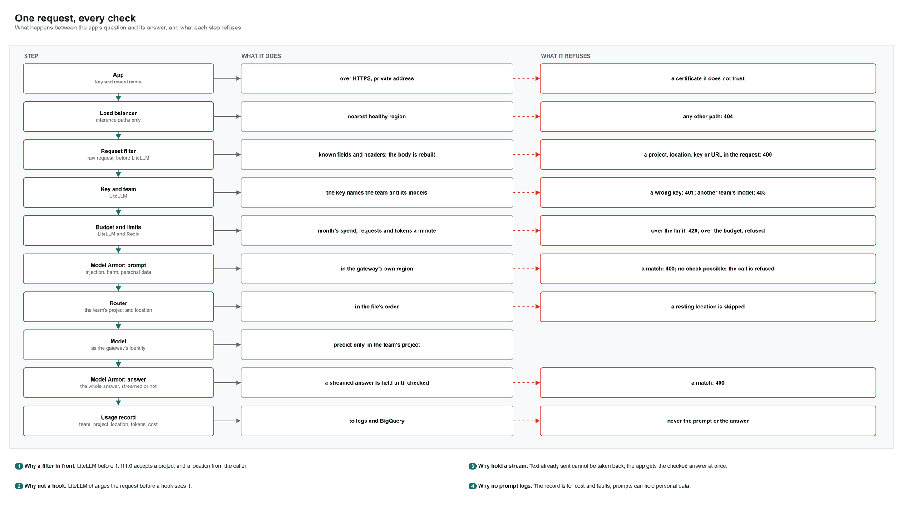
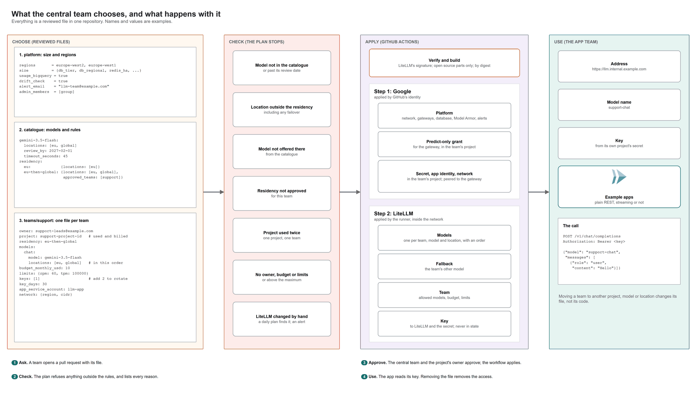
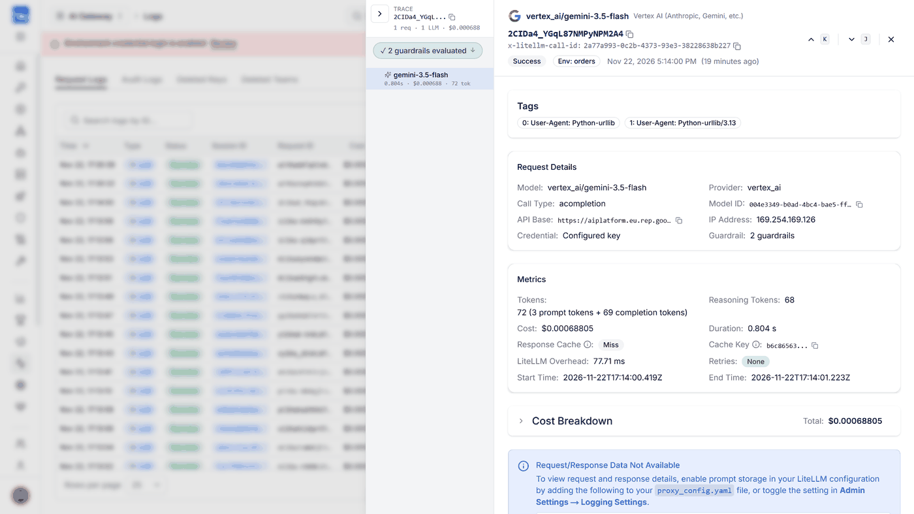

# A central LLM gateway on Google Cloud, with LiteLLM

One private REST address that every team in an organisation uses to call language models. A central team decides, per
team, which Google Cloud project pays, which models and locations are allowed, what it may spend, and what happens when
a location is down. Terraform builds it, GitHub Actions delivers it, and checks prove it after every deploy.

It runs [LiteLLM](https://github.com/BerriAI/litellm) on Cloud Run. This project is not affiliated with BerriAI.



- [What you get](#what-you-get)
- [One address, many teams](#one-address-many-teams)
- [How a request is checked](#how-a-request-is-checked)
- [Start](#start)
- [Try it on your machine](#try-it-on-your-machine)
- [Add a team](#add-a-team)
- [Call it from an app](#call-it-from-an-app)
- [When something is down](#when-something-is-down)
- [Run it: keys, upgrades, the admin UI, alerts, cost by team](#run-it)
- [Choose: size, regions, residency, options](#choose)
- [What it costs](#what-it-costs)
- [Security model](#security-model)
- [What was tested, and what was not](#what-was-tested-and-what-was-not)
- [Container images](#container-images)
- [Licences](#licences)

## What you get

- **One address for every team**, inside your network: a cross-region internal load balancer in front of Cloud Run in
  two regions, with automatic failover.
- **Each team in its own project.** Model calls run in, and are billed to, the team's own Google Cloud project, with its
  own quota.
- **Rules as files.** A model catalogue, and one file per team. A plan that breaks a rule stops and lists every reason.
- **[Model Armor](https://cloud.google.com/security/products/model-armor) on every prompt and every answer**, streamed or
  not. When it cannot check, the call is refused.
- **No way round it.** A request filter in front of LiteLLM, only the inference paths, default URLs off, no internet
  route, and apps with no model access of their own.
- **Cost by team**, in LiteLLM and in BigQuery, without storing prompts or answers.
- **Keyless delivery** by GitHub Actions, and LiteLLM's image signature verified before every build.

## One address, many teams

Both example apps call **the same URL, the same path and the same request**. The key decides everything else.


| | Orders team | Support team |
|---|---|---|
| Address | `https://llm.internal.example.com` | the same |
| Request | `POST /v1/chat/completions` | the same |
| Google Cloud project used and billed | its own | its own |
| Key | in a secret in its own project, readable only by its app's service account | the same, in its own project |
| Models | `orders-fast`, `orders-backup` | `support-chat` |
| Residency | `eu` only | `eu`, then `global` (approved in the catalogue) |
| When `eu` is down | another model in `eu`, then an error | the same model in `global` |
| Budget and limits | its own | its own |

### Who may do what (IAM)

| Identity | In the gateway project | In a team's project |
|---|---|---|
| Gateway (`<name>-gateway`) | read its secrets, call Model Armor | **predict only** (`aiplatform.endpoints.predict`), through a custom role |
| Admin service (`<name>-admin`) | read its secrets | nothing: it cannot call a model |
| Runner (`<name>-runner`) | read the master key, call the admin service, its own state bucket | write the team's key to the team's one secret |
| The team's app (`llm-app`) | nothing | read the team's one secret. **No model access** |
| People in `admin_members` | open the admin service (Cloud Run IAM), then log in to LiteLLM | nothing |
| GitHub Actions (`<name>-github`) | deploy, from one repository and one environment | deploy the rows above |

An app that calls the model API directly with its own identity gets a 403. A team's key cannot name another team's
model. Two teams' networks are each peered to the gateway's, and not to each other.

## How a request is checked



**Why a filter in front of LiteLLM.** Before 1.111.0, LiteLLM accepts `vertex_project` and `vertex_location` in a
request. Without the filter, one team's key was served from another team's project, and from the `us` location. The
filter ([gateway/guard.py](gateway/guard.py)) sees the raw request, allows only known paths, fields and headers, and
passes on a rebuilt body. A LiteLLM hook cannot do this: LiteLLM has already changed the body when the hook sees it.

**Streaming.** Because the whole answer is checked, a streamed answer arrives at once, after the check. That is the
price of checking answers: text already sent cannot be taken back.

## Start

You need a gateway project, one project per team, and an owner of all of them for the bootstrap.

```bash
# 1. once: APIs, the state bucket, the image repository, and a keyless identity for GitHub Actions
PROJECT=my-gateway TEAM_PROJECTS="orders-project support-project" GITHUB_REPO=owner/repo \
  REGION=europe-west2 scripts/bootstrap.sh
```

2. In GitHub, create the environment **`gateway`**: allow only the `main` branch, add reviewers, and set these variables
   (the bootstrap prints the first three):

| Variable | Example |
|---|---|
| `GCP_PROJECT`, `GCP_IDENTITY`, `GCP_PROVIDER` | printed by the bootstrap |
| `GCP_REGION` | `europe-west2` |
| `SETTINGS_DIR` | `settings/mycompany` (default `settings/example`) |
| `PLATFORM_TFVARS` | JSON of [terraform/platform/variables.tf](terraform/platform/variables.tf): `{"domain": "llm.example.internal", "alert_email": "llm-team@example.com", "admin_members": ["group:llm-admins@example.com"]}` |
| `APP_MEMBERS` | JSON: who may open the example apps |
| `EXAMPLE_PROJECTS` | only with the example settings: `{"orders-project-id": "...", "support-project-id": "..."}` |

3. Run the **deploy** workflow:

| Action | Does |
|---|---|
| `plan` | verifies and builds the images, shows what step 1 would change |
| `apply` | step 1 (Google Cloud), step 2 (LiteLLM's settings), the example apps, then the checks |
| `settings` | a settings change only: the gateways and apps are not redeployed |
| `checks` | runs the checks again, as each team |
| `destroy` | removes everything |

The first apply takes about 20 minutes, most of it Cloud SQL. `destroy` ends with an error about subnets: Cloud Run
keeps their addresses for an hour or two. Everything that costs money is gone by then; run it again later.

> Workflow logs show project ids. Keep the repository you deploy from private.

**Two steps, two states.** Step 1 (`terraform/platform`) is Google Cloud, applied by GitHub. Step 2
(`terraform/config`) is LiteLLM's models, teams and keys, through
[LiteLLM's provider](https://github.com/BerriAI/terraform-provider-litellm). It is applied by the **runner**, a Cloud Run
job inside the network, so the admin service is never public and GitHub never holds the master key.



## Try it on your machine

No cloud account, no cost: the published image with pretend models, an admin UI and the request filter.

```bash
cd local && docker compose up -d
# admin UI http://127.0.0.1:4000/ui/ (admin, sk-local-admin); apps call http://127.0.0.1:4001
```

## Add a team

Add `settings/<yours>/teams/<team>.yaml` and open a pull request:

```yaml
owner: support-leads@example.com
project: support-project-id     # where its model calls run and are billed
residency: eu-then-global       # in the catalogue; needs the team's name there
models:
  chat:                         # the app calls it support-chat
    model: gemini-3.5-flash
    locations: [eu, global]     # tried in this order
budget_monthly_usd: 10
limits: {rpm: 60, tpm: 100000}
keys: [1]
key_days: 30
app_service_account: llm-app    # made for the team; the only reader of its key
network: {region: europe-west1, cidr: 10.71.0.0/24}   # leave out when the project already reaches the gateway
```

The plan stops, and lists every reason, when: the model is not in the catalogue or is past its review date; a location is
not offered or is outside the residency; the residency is not approved for the team; a project is used by two teams; the
budget, limits or key life are missing or too high. Then run `bootstrap.sh` for the new project and the `settings`
action.

To remove a team, delete its file: its grant, key, secret and network go.

## Call it from an app

```bash
curl https://llm.internal.example.com/v1/chat/completions \
  -H "Authorization: Bearer $LLM_KEY" -H "Content-Type: application/json" \
  -d '{"model": "support-chat", "messages": [{"role": "user", "content": "Hello"}]}'
```

[apps/llm.py](apps/llm.py) is a whole client in 60 lines of standard-library Python. Any OpenAI-compatible SDK works too:

```python
from openai import OpenAI

client = OpenAI(base_url="https://llm.internal.example.com/v1", api_key=key)
answer = client.chat.completions.create(model="support-chat", messages=[{"role": "user", "content": "Hello"}])
```

Send only standard chat fields: others are refused with a 400 that names them. SDKs that add their own fields
(`metadata`, `store`, `extra_body`) must leave them out.

| The app gets | It should |
|---|---|
| 400 `fields not allowed` | fix the request |
| 400 `blocked by Model Armor` | show the reason; not retry |
| 401, 403 | check its key and model name; not retry |
| 422 `budget_exceeded` | stop: the month's budget is spent |
| 429 | wait and retry |
| 5xx | wait and retry |
| an error inside a stream | treat the answer as incomplete |

Set the app's time limit above the failover time: the sum of `timeout_seconds` for the locations it may try.

The two example apps ([apps/app.py](apps/app.py)) run in two different projects:

| Order reader (team orders) | Support chat (team support) |
|---|---|
|  |  |

## When something is down


| | Measured on a real deployment |
|---|---|
| A region's gateway fails its readiness | traffic moved to the other region and back; 1 of 379 calls failed, during a 35-second database restart |
| A release that is not ready | never gets traffic; the old one keeps serving |
| The `eu` model location is cut off | the team with `eu, global` is served from `global`; the `eu`-only team gets an error and never leaves the EU |
| The first call to a dead location | waits for `timeout_seconds` (45), then the location rests for two minutes |
| The alert for it | open about four minutes after the first failure |

**Know these:**

- **There is one database.** While it is down, keys cannot be checked and calls are refused. See
  [a database replica](#a-database-replica).
- **The `eu` location is reached through a private endpoint in an EU region.** A region outside the EU (London) depends on
  the EU one for it. For EU residency that survives a region, use two EU regions, for example `europe-west1` and
  `europe-west4`.
- **The gateway itself processes prompts in its own region**, and so does Model Armor. For strict EU processing, run both
  gateways in the EU.
- **Limits are counted in each region's Redis**, so 60 a minute can allow 120 across two regions. Budgets are in the
  database and written every 10 seconds, so a team can go slightly over.
- **If Redis fails, calls go on** and limits are counted per instance. There is an alert for it.

## Run it

**Rotate a key** with no gap: `keys: [1, 2]`, run `settings`, restart the app (it now reads 2), then `keys: [2]`. Both
work in between; the old one answers 401 at the end. Keys expire after `key_days`: rotate before that.

**Open the admin UI.** Give people access with `admin_members`, then, from a machine that can reach it
(`admin_public_ingress` allows that from outside the network; IAM still applies):

```bash
ADMIN_URL=$(terraform -chdir=terraform/platform output -raw admin_url) python runner/admin_proxy.py
# http://127.0.0.1:9000/ui/  user: admin  password: the <name>-master-key secret
```

Look, and change settings in Git: the daily drift check (`drift_check`) finds changes made by hand, alerts, and the next
apply puts them back. For production, make a named admin in LiteLLM and set
`general_settings.disable_env_credential_login: true`, so the master key is not a login.

| Team | One request |
|---|---|
|  |  |

**Cost by team** in BigQuery (one line per call; no prompts):

```sql
select jsonPayload.llm_usage.team, jsonPayload.llm_usage.project, jsonPayload.llm_usage.location,
       count(*) calls, round(sum(jsonPayload.llm_usage.cost_usd), 2) usd
from `my-gateway.llmgw_usage.run_googleapis_com_stdout`
where jsonPayload.llm_usage.ok group by 1, 2, 3 order by usd desc
```

**Alerts:** models failing in a location; Redis failing; Model Armor failing; requests with fields that are not allowed;
the settings run failing or finding changes; gateway 5xx; the database down.

**Upgrade LiteLLM:** put a new digest in [LITELLM_IMAGE](LITELLM_IMAGE) and the same version in
[terraform/config](terraform/config/main.tf), then `apply`. The signature is verified, the migration runs first, and an
unready revision gets no traffic. Pin digests of the LTS line, and let a release age about a week unless it fixes a
security fault: on 21 October 2026 the `latest` and `main-stable` tags briefly carried malware. Roll back by reverting the commit, if the
migration allows it: take a database backup first.

**Turn a team off now:** block its key or team in the admin UI, then remove its file.

## Choose

| Setting | Trial (the default) | Production |
|---|---|---|
| `size.db_tier`, `db_connections` | `db-g1-small`, 50 | `db-custom-2-7680`, 400 |
| `size.db_regional` | false | true: survives a zone |
| `size.redis_ha` | false | true |
| `size.gateway_maximum` | 3 | by load: each instance uses 5 database connections; the plan checks the sum |
| `certificate_ids` | none: a private CA is made (its key is in the Terraform state) | your Certificate Manager certificates, scope `ALL_REGIONS` |
| `deletion_protection` | set false for a trial | true (the default) |
| `drift_check`, `alert_email` | off | on |
| `regions` | two | two; both in the EU for EU residency |

Not built, with what it would take:

### A database replica

Cloud SQL Enterprise is enough: create a cross-region replica, point `db.<name>.internal` at it, and promote it with a
script. You run the failover yourself, recent writes can be lost (replication is asynchronous), and failing back means
making a new replica. Enterprise Plus adds managed switchover and a write endpoint, at about four times the extra price.

### Single sign-on

LiteLLM's own single sign-on is free for up to five users and an Enterprise feature beyond. Without it: Cloud Run IAM
already decides who reaches the admin service; Identity-Aware Proxy can put your identity provider in front of it; or a
small portal of your own can call LiteLLM's admin API for self-service. Teams do not need the UI: they change files.

### Others

Guardrails per team, and LiteLLM's own audit log (Enterprise features of LiteLLM); other model providers (they need a
controlled way out, as there is no internet route); customer-managed keys; a prompt archive; caching; MCP and agents.

## What it costs

List prices in GBP, November 2026, London and Belgium, 730 hours, before tokens:

| | Trial | Production |
|---|---|---|
| Two gateways (1 vCPU, 4 GiB, always on) | 113 | 113 |
| Cloud SQL | 25 | 184 |
| Redis, two regions (1 GB; with replicas in production) | 57 | 97 |
| Load balancer, two regions | 58 | 58 |
| Private endpoints, admin service, logs, secrets, DNS (estimate) | 25 | 30 |
| **A month** | **about 280** | **about 480** |

Tokens are usually the larger part: 100,000 calls of 1,000 tokens in and 300 out on Gemini 3.5 Flash in `eu` are about
350. Model Armor's first 2 million tokens a month are free, then about 0.08 per million.

## Security model

- **No internet route.** No NAT; Google is reached through Private Google Access, and private endpoints for the `eu`
  location and Model Armor. A compromised dependency has nowhere to send anything.
- **Predict only.** The gateway's identity can call models in team projects and do nothing else there. It can do so in
  every team's project: protect it, and keep the filter.
- **Keys are never in Terraform state or plans**: made in memory, sent with write-only arguments. Redis's password, and
  the trial CA's private key, are in the state; its bucket is private and versioned.
- **The image** is verified (cosign, keyless), pinned by digest, runs as a non-root user, and holds only LiteLLM's open
  source parts.
- **The salt key must never change**: it encrypts what LiteLLM keeps in the database.
- **Apps that could go round** must not hold `aiplatform` roles in their projects; consider VPC Service Controls.
- **GitHub Actions** can deploy to all these projects. Its identity is accepted only from one repository's `gateway`
  environment: protect that environment with reviewers.

Report a fault privately through GitHub's security advisories.

## What was tested, and what was not

Tested on a real deployment, trial size, 22 November 2026, LiteLLM 1.108.15: 29 checks as each of two teams
([apps/check.py](apps/check.py)); both failovers; drift; key rotation; the alerts for models and for settings; BigQuery
usage; 600 calls from one client at 114 a second (`GET /v1/models`, median 165 ms, no errors); teardown.

The published image (open source parts only) was tested on a workstation with real models and Model Armor: calls,
failover, streaming, the filter, limits, the migration, the admin UI and the Terraform settings step. The Cloud Run runs
above used the same code on LiteLLM's full image.

Not tested: the loss of a whole Google Cloud region, production sizes, sustained load, your own certificates, Shared VPC
and on-premises callers, embeddings, and the drift schedule (its job was run by hand).

## Container images

| Image | For |
|---|---|
| `ghcr.io/fluxorsoft/llm-gateway/gateway` | the gateway and the admin service |
| `ghcr.io/fluxorsoft/llm-gateway/runner` | applies the settings; add yours: `FROM` it, `COPY settings /repo/settings/current` |
| `ghcr.io/fluxorsoft/llm-gateway/app` | the example apps and the checks |

They are signed. Verify with cosign 3 or newer:

```bash
cosign verify ghcr.io/fluxorsoft/llm-gateway/gateway:1.0.0 \
  --certificate-identity-regexp '^https://github.com/fluxorsoft/llm-gateway/' \
  --certificate-oidc-issuer https://token.actions.githubusercontent.com
```

Cloud Run cannot pull from GHCR directly: copy them by digest to
your Artifact Registry, or let the workflow build its own.

## Licences

This repository is [Apache 2.0](LICENSE). LiteLLM is MIT, except its `enterprise` folder, whose licence does not allow
production use or distribution without an agreement with BerriAI. The gateway does not use it, so
[the image](gateway/Dockerfile) leaves it out. The runner image includes Terraform (Business Source License 1.1).
"LiteLLM" is BerriAI's name, used here to say what this runs.
